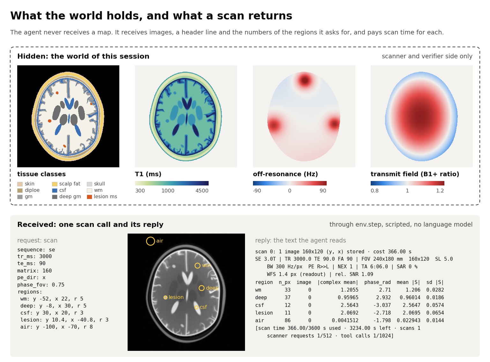
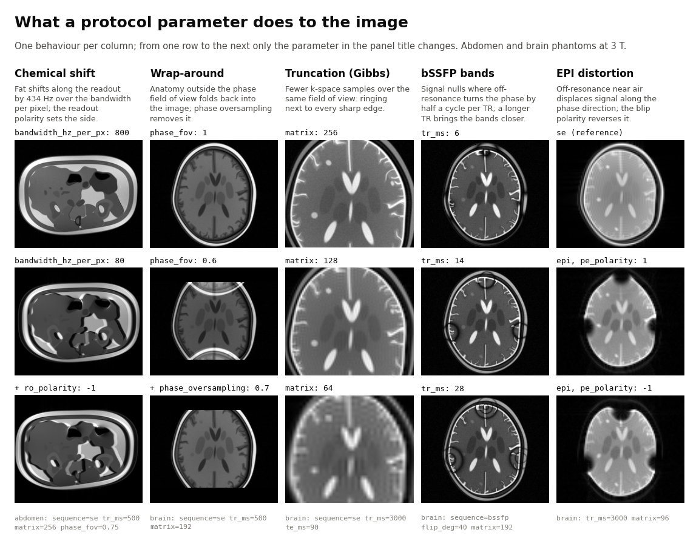

<p align="center">
  
</p>

<p align="center">
  <a href="https://github.com/KeWang0622/MRGym/actions/workflows/tests.yml"></a>
  <a href="LICENSE"></a>
</p>

**MR Gym is a virtual MRI scanner you can drop an AI agent into.**
The agent plans and runs scans on an object it cannot see, inside a fixed scan-time budget, and delivers a measurement
or a protocol. The scanner scores what was delivered against the hidden object.

Every episode draws a new object and a new system state from a seed, so one environment serves training and testing.
[MRI Agent Bench](https://github.com/KeWang0622/MRIAgentBench) remains the held-out evaluation; none of its tasks are
used here.

[Environments](envs/) · [Scanner manual](docs/scanner.md) · [Physics validation](docs/physics/validation.md) ·
[Results](results/) · [Limits](docs/physics/limits.md) · [Design](docs/DESIGN.md)

<!-- COUNTS:START -->
| 6 sequences | 3 phantoms | 2 field strengths | 25 tissue rows, each with a source tag | 38 physics checks | 3 environments (admitted, practice, sandbox) |
|---|---|---|---|---|---|
<!-- COUNTS:END -->

## Run an episode

```bash
git clone https://github.com/KeWang0622/MRGym.git
cd MRGym
pip install -e .
mrgym demo
```

Python 3.10 or later, numpy and scipy. No GPU and no network. This is what `mrgym demo` prints: one episode of
`Scanner/NoWrap-v0` played by a scripted policy, then other scripted policies on the same hidden object.

<!-- DEMO:START -->
```text
$ mrgym demo
Scanner/NoWrap-v0 · level 1 · seed 0 · policy reference (scripted, no language model)
  agent -> scanner_info {}
      (instrument card, 1784 characters)
  agent -> scan {"protocol":{"sequence":"spgr","tr_ms":10.0,"flip_deg":10.0,"fov_mm":288.0,"matrix":160,"averages":2},"regions":[]}
      scan 0: 1 image 160x160 (y, x) stored · cost 10.20 s
      SPGR 1.5T | TR 10.0 TE 2.7 FA 10 | FOV 288x288 mm  160x160  SL 5.0 | BW 300 Hz/px  PE A>>P | NEX 2 | TA 0:10.2 | SAR 0 % | WFS 0.7 px (readout) | rel. SNR 1.28
      no regions requested
  agent -> view {"scan":0,"image":0,"kind":"magnitude"}
      scan 0 (spgr), image 0, magnitude, 160x160 (y, x), FOV 288 x 288 mm
      extent of pixels above 20 % of the 99.5th percentile: y -89.1 .. 87.3 mm, x -67.5 .. 62.1 mm
      32x32 block means, one digit per 9.0 x 9.0 mm block (y, x), 0-9 spans 0..0.3425; row = y (top = -144 mm), column = x (left = -144 mm)
  agent -> submit {"pe_dir":"x","fov_mm":184.0,"phase_fov":0.76087,"matrix":92,"phase_oversampling":0.0}
      geometry received; the episode is over
      reward 1.000 · delivered scan 38.5 s (70 lines) · fastest valid 38.5 s · safe geometry 68.5 s · gates: resolution True, whole object True, no wrap True (wrap energy 2.0e-05), measured True, log True
  reward 1.000 · 1 scan(s), 10.2 of 30 s of scan time · scanner log replays: True
the same hidden world, other scripted policies:
  prior            reward 0.000   no scan in the log
  console_default  reward 0.158   not within tolerance
  fixed_recipe     reward 0.514   not within tolerance
  brute_force      reward 0.593   not within tolerance
  wrong_units      reward 0.000   the console rejects this geometry: fov_mm=18.4 outside [80.0, 500.0] mm, along the readout direction (a field of view of this size looks like centimetres)
  no_swap          reward 0.676   not within tolerance
  size_only        reward 0.000   part of the object lies outside the image
  safe_max         reward 0.000   not within tolerance
```
<!-- DEMO:END -->

The same loop from Python, through the public API only ([examples/first_episode.py](examples/first_episode.py)):

```python
import mrgym

env = mrgym.make("Scanner/NoWrap-v0", level=2, seed=0)
obs, info = env.reset()                                    # the task statement; a new hidden object
tools = env.tools("openai")                                # or "anthropic", "mcp"
obs, reward, terminated, truncated, info = env.step({"name": "scan", "arguments": {"protocol": {
    "sequence": "spgr", "tr_ms": 10, "flip_deg": 10, "fov_mm": 288, "matrix": 160, "averages": 2}}})
```

`reset`, `step` and `state` belong to whoever runs the episode. The agent sees tools only: `scanner_info`, `plan`,
`scan`, `read_regions`, `view`, and one terminal tool. No tool resets the world or reads it.

<p align="center">
  
</p>

## What is on the scanner?

| Call | Cost | Returns |
|---|---|---|
| `scanner_info` | free | The instrument card, the sequences and their parameters, the task |
| `plan` | free | The realised protocol, its timing, scan seconds and limits, the header line. Never any signal |
| `scan` | scan seconds | The header line and read-outs of the regions the agent chose; images are stored |
| `read_regions`, `view` | free | Other regions of a stored scan; one stored image with its extent in mm |

Six sequences run today: spoiled gradient echo (one to eight echoes), actual flip-angle imaging, spin echo, inversion
recovery, balanced SSFP and single-shot EPI, on one slice at 1.5 or 3 T. Three procedural phantoms lie on the table:
a head, an abdomen and a QA phantom with vials. Images are formed in k-space, so field of view, matrix, bandwidth
and phase direction act where they act on a scanner. The object, the transmit and receive fields, the off-resonance
and the noise level are hidden. The [scanner manual](docs/scanner.md) is everything the agent is told.

<p align="center">
  
</p>

<p align="center">
  
</p>

<p align="center">
  
</p>

Operate it yourself. `mrgym scan` runs one protocol and writes the image; `mrgym play` is a console session.

```bash
mrgym scan sequence=se tr_ms=500 te_ms=15 matrix=256 --out mrgym_out/brain_t1w.png
mrgym scan --phantom abdomen sequence=spgr tr_ms=120 flip_deg=70 te_ms=3.45 matrix=192 --out mrgym_out/abdomen_opposed_phase.png
mrgym play --phantom brain --lesion ms
```

## What are the environments?

<!-- ENVS:START -->
| Environment | Given | Deliver | Scored by | Admission gate |
|---|---|---|---|---|
| [`Scanner/Explore-v0`](envs/scanner-explore-v0/) | A head, an abdomen or a QA phantom at 1.5 or 3 T; one hour of scan time | Nothing | No reward | no reward |
| [`Scanner/NoWrap-v0`](envs/scanner-nowrap-v0/) | An object of hidden size, orientation and position; the scanner; 30 s of scan time for localisers | Geometry of a spin-echo scan: phase-encode axis, field of view, phase field of view, matrix | Re-scan on the hidden object: whole object inside, no wrap-around, pixel as required; then scan time against the fastest valid geometry | admitted: 28/48 instances (58%) |
| [`Scanner/T1Transmit-v0`](envs/scanner-t1transmit-v0/) | A QA phantom with 4 to 7 vials, the scanner, a scan-time budget of 45 to 100 s | T1 of every marked vial, in ms | RMS relative T1 error against the hidden phantom; full marks inside the reference policy's own noise band | practice: rejected by its gate (0/72 instances admitted) |
<!-- ENVS:END -->

An **environment** is one job on the scanner with its own scoring rule. A **level** sets the hidden-world prior and
the budget. An **episode** is one seeded attempt. An environment is admitted only when a reference policy passes and
every shortcut policy fails: the no-scan answer, the best constant recipe, a blind sweep, the right numbers in the
wrong unit, a seed attack. `mrgym check <id>` runs the gate; a rejected environment is listed as rejected.

```bash
mrgym list
mrgym check Scanner/NoWrap-v0
```

## Watch an episode

<p align="center">
  
</p>

This episode is real and scripted: the reference policy, no language model. Record any episode as one file and step
through it in a one-file viewer; a recorded example is in [examples/episode/](examples/episode/).

```bash
mrgym record Scanner/NoWrap-v0 --level 2 --seed 0 --policy reference --out runs/demo
mrgym view runs/demo/episode_bundle.json --out runs/demo/viewer.html
```

## Current results

<!-- RESULTS:START -->
1200 episodes, played 2026-11-24 (UTC) on engine `mrgym-engine-0.1.0`, package 0.1.0.dev0; public train split, seeds 0-23; every agent plays the same instances. Cells are episodes passed. Scripted policies only: no language model has been run.

| Environment | Level | Instances (admitted by the gate) | Reference policy | Best constant recipe | Blind sweep | No-scan answer |
|---|---:|---:|---:|---:|---:|---:|
| `Scanner/NoWrap-v0` | 1 | 24 (13) | 24/24 (100%) | 6/24 (25%) | 0/24 (0%) | 0/24 (0%) |
| `Scanner/NoWrap-v0` | 2 | 24 (15) | 24/24 (100%) | 5/24 (21%) | 3/24 (12%) | 0/24 (0%) |
| `Scanner/T1Transmit-v0` | 1 | 24 (0) | 24/24 (100%) | 24/24 (100%) | 0/24 (0%) | 0/24 (0%) |
| `Scanner/T1Transmit-v0` | 2 | 24 (0) | 24/24 (100%) | 23/24 (96%) | 0/24 (0%) | 0/24 (0%) |
| `Scanner/T1Transmit-v0` | 3 | 24 (0) | 24/24 (100%) | 24/24 (100%) | 0/24 (0%) | 0/24 (0%) |
<!-- RESULTS:END -->

The least favourable reading: on `Scanner/T1Transmit-v0` the best constant recipe passes about as often as the
reference policy, which is why its gate rejects it. On `Scanner/NoWrap-v0` a constant geometry passes on some
instances, and the gate does not admit those.

No language model has been run yet: every row is a scripted policy. These are maintainer-run results on simulated
objects. The generator is public, so no level is secret. No environment has had independent expert review. A pass
here does not establish that an agent can operate a real scanner. Model rows are added by `mrgym run-agent` into the
same folder; [results/](results/) gives the command, the per-episode records and the denominators.

```bash
mrgym results --check
```

## Check the physics

`mrgym validate` compares the scanner with analytic formulas and with Bloch calculations written separately from the
engine; [the table](docs/physics/validation.md) names the reference of every row.
[conventions.md](docs/physics/conventions.md) states units, signs and axes; [limits.md](docs/physics/limits.md) says
what is simplified; [examples/textbook/](examples/textbook/) holds the classic experiments as scripts.

```bash
mrgym validate
mrgym timing
```

Seconds of computation per scan on the brain phantom (one thread; regenerate with `python tools/generate.py --timing`):

<!-- TIMING:START -->
| Sequence | matrix 64 | matrix 128 | matrix 256 |
|---|---:|---:|---:|
| spgr | 0.21 | 0.22 | 0.26 |
| spgr, 4 echoes | 0.54 | 0.60 | 0.74 |
| afi | 0.37 | 0.40 | 0.48 |
| se | 0.19 | 0.21 | 0.26 |
| ir | 0.19 | 0.21 | 0.26 |
| bssfp | 0.21 | 0.23 | 0.28 |
| epi | 0.23 | 0.26 | refused |

world generation, once per episode: brain 0.66 s, abdomen 0.66 s, qa 0.07 s
brain phantom at 3 T, one thread, median of 3, noise-free data not cached; a repeated protocol reuses it
<!-- TIMING:END -->

## Limits

- One slice, one receive channel, hard pulses without a slice profile, steady state served without the transient.
- No fast spin echo and no motion: a T2-weighted scan takes minutes, and the RF power limit rarely binds.
- Tissue is piecewise constant and the anatomy is schematic.
- `Scanner/T1Transmit-v0` is rejected by its own gate (one constant protocol passes) and stays as a practice task.
- `Scanner/NoWrap-v0` is a small task: one look, one decision. It is the first admitted environment, not a hard one.
- The gate shows that the listed shortcut policies fail. It does not prove that no shortcut exists.

[limits.md](docs/physics/limits.md) gives each item with its size where it was measured.

## Repository

| Path | Contents |
|---|---|
| [`src/mrgym/scanner/`](src/mrgym/scanner/) | World (anatomy, tissue table, fields), console, signal models, k-space engine, session log and replay, HTTP service |
| [`src/mrgym/envs/`](src/mrgym/envs/) | Environments: task, control policies and binding for each id; stored gate results |
| [`src/mrgym/`](src/mrgym/) | `make` / `reset` / `step`, registry, tools, recorder, viewer, validation, model runner |
| [`envs/`](envs/) | Generated environment cards |
| [`docs/`](docs/) | Scanner manual, physics validation, conventions, limits, references, design |
| [`examples/`](examples/) | First episode, textbook experiments, a recorded episode, a model-runner example |
| [`results/`](results/) | Episode records and the generated results table |
| [`tools/`](tools/) | `generate.py` (generated files and their check), figure scripts |
| [`extras/recon_repair/`](extras/recon_repair/) | A code-repair task set that is not part of `mrgym`; read its warning first |

## Skills and evaluation

[MRFoundry](https://github.com/KeWang0622/MRFoundry) holds skills, tools and project memory for MRI research agents.
[MRI Agent Bench](https://github.com/KeWang0622/MRIAgentBench) holds held-out, executable MRI research tasks.
MR Gym is where an agent practises on the scanner. No task, data or grader of MRI Agent Bench is used here, and
[a test](tests/test_no_benchmark_content.py) keeps it that way.

## Contribute and cite

[CONTRIBUTING.md](CONTRIBUTING.md) explains how to add an environment and what its gate must show.
[CITATION.cff](CITATION.cff) gives the citation. Code is Apache-2.0. This is a research preview.

```bash
pip install pytest
pytest -q
python tools/generate.py --check
```
