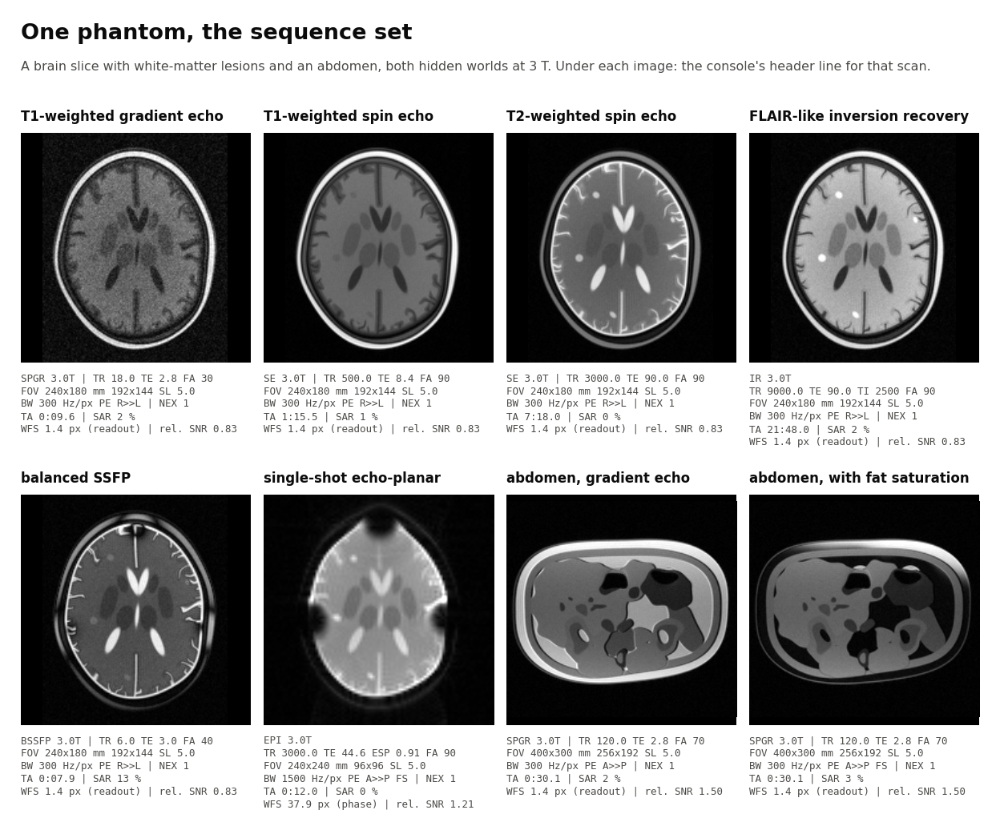

<h1 align="center">MR Gym</h1>

<p align="center">
  <b>A virtual MRI scanner for AI agents.</b><br>
  An open reinforcement-learning environment: the agent runs scans, the scanner scores what it delivers.
</p>

<p align="center">
  
</p>

<p align="center">
  <a href="LICENSE"></a>
</p>

**MR Gym is a virtual MRI scanner you can drop an AI agent into.**
The agent plans and runs scans on an object it cannot see, inside a fixed scan-time budget, and delivers a measurement
or a protocol. The scanner scores what was delivered against the hidden object.

Every episode draws a new object and a new system state from a seed, so one environment serves training and testing.
[MRI Agent Bench](https://github.com/KeWang0622/MRIAgentBench) remains the held-out evaluation; none of its tasks are
used here.

[Environments](envs/) · [Scanner manual](docs/scanner.md) · [Physics validation](docs/physics/validation.md) ·
[Results](results/) · [Limits](docs/physics/limits.md) · [Design](docs/DESIGN.md)

<!-- COUNTS:START -->
| 6 sequences | 5 phantoms | 2 field strengths | 25 tissue rows, each with a source tag | 63 physics checks | 10 environments (admitted, practice, sandbox) |
|---|---|---|---|---|---|
<!-- COUNTS:END -->

## Run an episode

```bash
git clone https://github.com/KeWang0622/MRGym.git
cd MRGym
pip install -e .
mrgym demo
```

Python 3.10 or later, numpy and scipy. No GPU and no network. This is what `mrgym demo` prints: one episode of
`Scanner/NoWrap-v1` played by a scripted policy, then other scripted policies on the same hidden object.

<!-- DEMO:START -->
```text
$ mrgym demo
Scanner/NoWrap-v1 · level 2 · seed 0 · policy reference (scripted, no language model)
  agent -> scanner_info {}
      (instrument card, 1367 characters)
  agent -> scan {"sequence":"spgr","tr_ms":11.0,"flip_deg":10.0,"fov_mm":288.0,"matrix":160,"averages":2,"circles":[]}
      scan_index 0 · 1 image 160x160 (y, x) stored · cost 10.52 s · te_ms 3.33
      no regions requested
  agent -> view {"scan_index":0,"image_index":0,"kind":"magnitude"}
      scan_index 0 (spgr), image_index 0, magnitude, 160x160 (y, x), FOV 288 x 288 mm, pixel 1.8 x 1.8 mm
      16x16 block means, one digit per 18.0 x 18.0 mm block (y, x), 0-9 spans 0..0.4401; row = y (top = -144 mm), column = x (left = -144 mm); block centres: y_mm after each...
      0000000000000000 -136
  agent -> submit {"pe_dir":"y","fov_mm":168.0,"phase_fov":0.595238,"matrix":84,"centre_y_mm":-1.0,"centre_x_mm":16.3,"rotation_deg":90.0}
      deliverable received; the episode is over
      reward 1 · every check passed
  reward 1 · 1 scan(s), 10.5 of 30 s of scan time · scanner log replays: True
the same hidden world, other scripted policies:
  prior            reward 0   no scan in the log
  console_default  reward 0   the scan is slower than allowed
  fixed_recipe     reward 0   part of the object lies outside the image; the image shows wrap-around; the scan is slower than allowed
  brute_force      reward 0   the scan is slower than allowed
  wrong_units      reward 0   error invalid_value · fix: {"fov_mm": 168.0} · fov_mm: 16.8 is below the minimum 80.0; fov_mm expects millimetres; 16.8 cm = 168 mm
  size_only        reward 0   part of the object lies outside the image; the image shows wrap-around
  centred_only     reward 0   the scan is slower than allowed
  no_swap          reward 0   the scan is slower than allowed
  no_turn          reward 1   passed
  open_loop        reward 1   passed
  safe_max         reward 0   the scan is slower than allowed
```
<!-- DEMO:END -->

The same loop from Python, through the public API only ([examples/first_episode.py](examples/first_episode.py)):

```python
import mrgym

env = mrgym.make("Scanner/NoWrap-v1", level=2, seed=0)
obs, info = env.reset()                                    # the task statement; a new hidden object
tools = env.tools("openai")                                # or "anthropic", "mcp"
obs, reward, terminated, truncated, info = env.step({"name": "scan", "arguments": {
    "sequence": "spgr", "tr_ms": 10, "flip_deg": 10, "fov_mm": 288, "matrix": 160, "averages": 2}})
```

`reset`, `step` and `state` belong to whoever runs the episode. The agent sees tools only: `scanner_info`, `status`,
`plan`, `scan`, `read_regions`, `view`, `profile`, `calc`, and one terminal tool. No tool resets the world or reads it.

<p align="center">
  
</p>

## What is on the scanner?

| Call | Cost | Returns |
|---|---|---|
| `scanner_info` | free | The instrument card, the sequences and their parameters, the task |
| `plan` | free | The realised protocol, its timing, scan seconds and limits, the header line. Never any signal |
| `scan` | scan seconds | The header line and read-outs of the regions the agent chose; images are stored |
| `read_regions`, `view`, `profile` | free | Other regions of a stored scan; one stored image with its geometry; the numbers along a line through it |
| `status`, `calc` | free | Every limit of the episode and what is left of it; arithmetic |

Six sequences run today: spoiled gradient echo (one to eight echoes), actual flip-angle imaging, spin echo, inversion
recovery, balanced SSFP and single-shot EPI, on one slice at 1.5 or 3 T. Three procedural phantoms lie on the table:
a head, an abdomen and a QA phantom with vials. Images are formed in k-space, so field of view, matrix, bandwidth
and phase direction act where they act on a scanner. The object, the transmit and receive fields, the off-resonance
and the noise level are hidden. The [scanner manual](docs/scanner.md) is everything the agent is told.

<p align="center">
  
</p>

<p align="center">
  
</p>

<p align="center">
  
</p>

Operate it yourself. `mrgym scan` runs one protocol and writes the image; `mrgym play` is a console session.

```bash
mrgym scan sequence=se tr_ms=500 te_ms=15 matrix=256 --out mrgym_out/brain_t1w.png
mrgym scan --phantom abdomen sequence=spgr tr_ms=120 flip_deg=70 te_ms=3.45 matrix=192 --out mrgym_out/abdomen_opposed_phase.png
mrgym play --phantom brain --lesion ms
```

## What are the environments?

<!-- ENVS:START -->
| Environment | Given | Deliver | Scored by | Kind | Levels of the claim | Stored gate |
|---|---|---|---|---|---|---|
| [`Scanner/ArtefactClinic-v0`](envs/scanner-artefactclinic-v0/) | A test object with hidden materials, the protocol of an examination, findings a reader marked on its image, the requirements of the examination; scan time for experiments | For each finding its causes (or none: it is the object), and one protocol that images every finding cleanly inside the requirements | Noise-free re-scan of the delivered protocol on the hidden object against its counterfactual twins (the same protocol with the artefact mechanisms switched off, and the object averaged over each pixel); the diagnosis against the mechanisms that corrupt each finding in the complaint protocol | admitted | 1, 2, 3 | on 300 fresh instances per level the reference passes >= 99 %, no policy that ignores the object passes more than 7 % (95 % bounds) |
| [`Scanner/BandFree-v0`](envs/scanner-bandfree-v0/) | A test object with vials of hidden materials in a hidden, inhomogeneous field; the scanner; a scan-time budget for probing | For each of two balanced SSFP images: the receiver bandwidth (the repetition time is the console minimum for that bandwidth) and the phase cycle; two phase cycles when one acquisition cannot be band-free | Noise-free scans of the delivered protocols on the hidden object and the echo amplitudes on the marked regions over a drift of the centre frequency either way: every marked region of an image must keep its signal; the number of acquisitions and the bandwidth are compared with the best band-free protocol of the hidden object | admitted | 1, 2, 3 | on 300 fresh instances per level the reference passes >= 94 %, no policy that ignores the object passes more than 3 % (95 % bounds) |
| [`Scanner/Explore-v0`](envs/scanner-explore-v0/) | A head, an abdomen or a QA phantom at 1.5 or 3 T; one hour of scan time | Nothing | No reward | sandbox | - | no reward |
| [`Scanner/FatSuppress-v0`](envs/scanner-fatsuppress-v0/) | A test object with several fat-containing vials (a different fat in each) in a strongly inhomogeneous field; the scanner; a scan-time budget for probing | For each marked region the method of its fat-suppressed spin-echo image: spectral fat saturation, or inversion recovery with the inversion time | Noise-free scans of the target image on the hidden object: every region must be suppressed by its method, and inversion recovery passes only where fat saturation is not enough | admitted | 1, 2, 3 | on 300 fresh instances per level the reference passes >= 98 %, no policy that ignores the object passes more than 6 % (95 % bounds) |
| [`Scanner/NoWrap-v1`](envs/scanner-nowrap-v1/) | An object of hidden size, position and orientation; the scanner; 30 s of scan time for localisers | Geometry of a spin-echo scan: phase-encode axis, field of view, phase field of view, matrix, centre, rotation | Re-scan on the hidden object: whole object inside, no wrap-around, pixel as required, scan time within 10 % of the fastest such geometry | admitted | 2, 3 (practice: 0, 1) | on 300 fresh instances per level the reference passes >= 99 %, no policy that ignores the object passes more than 6 % (95 % bounds) |
| [`Scanner/NullTissue-v0`](envs/scanner-nulltissue-v0/) | A test object with vials of hidden materials; the scanner; a scan-time budget for probing | For each marked region, the inversion time that nulls it in an inversion-recovery scan with a given repetition time | Noise-free scans of the target protocol on the hidden object: every marked region must be nulled by its inversion time | admitted | 1, 2, 3 (practice: 0) | on 300 fresh instances per level the reference passes >= 92 %, no policy that ignores the object passes more than 3 % (95 % bounds) |
| [`Scanner/PhantomQA-v0`](envs/scanner-phantomqa-v0/) | The uniform section of the ACR large phantom in a scanner with zero, one or two hidden faults; the site's ACR T1 protocol; the limits of the ACR guidance; a closed list of seven faults; a scan-time budget | The four test quantities measured on the ACR T1 scan, the tests that fail, and the faults of the system | A noise-free scan of the same protocol on the hidden system: the values must agree with the verifier's measurement, the verdicts with the guidance's limits, the faults with the hidden state | admitted | 1, 2, 3 | on 300 fresh instances per level the reference passes >= 99 %, no policy that ignores the object passes more than 3 % (95 % bounds) |
| [`Scanner/ProtocolToSpec-v0`](envs/scanner-protocoltospec-v0/) | A test object with vials of hidden materials; the scanner; the standard protocol of a two-image inversion-recovery examination; a scan-time budget for the standard protocol at low resolution and one repeat of it | For each of the two images: inversion time, echo time and number of averages (the averages share one scan-time limit) | Noise-free scans of the delivered protocols on the hidden object with the analytic noise of the hidden receiver: a T1 contrast ratio, a T2 contrast ratio and an SNR must hold for each image, and the scan times of the two images together must stay within a limit | practice | 1, 2, 3 | level(s) 1, 3 admitted; fixed_recipe#2 passes 25 of 300 (upper bound 11.4 % > 10 %) |
| [`Scanner/SNRSpec-v0`](envs/scanner-snrspec-v0/) | A test object with vials of hidden materials; the scanner; a scan-time budget for probing | For each of two spin-echo images of prescribed geometry: repetition time, number of averages and receiver bandwidth | Noise-free scans of the delivered protocols on the hidden object with the analytic noise of the hidden receiver: every marked region must reach its required SNR, in a scan time within a stated factor of the shortest that does (exhaustive search on the hidden world) | admitted | 1, 2, 3 | on 300 fresh instances per level the reference passes >= 97 %, no policy that ignores the object passes more than 3 % (95 % bounds) |
| [`Scanner/T1Transmit-v1`](envs/scanner-t1transmit-v1/) | A QA phantom with 4 to 7 vials, the scanner, a scan-time budget | T1 of every marked vial, in ms | The hidden T1 of every vial: each delivered value within a factor 1.1 of it | practice | 1, 2, 3 | level(s) 1 admitted; ignores_profile loses only 9.0 points against the reference (lower bound 6.3 < 25) |
<!-- ENVS:END -->

An **environment** is one job on the scanner with its own scoring rule. A **level** sets the hidden-world prior and
the budget. An **episode** is one seeded attempt. A level is admitted only when, on fresh instances, a reference policy passes,
every shortcut policy fails (the no-scan answer, the best constant recipe, a blind sweep, the right numbers in the
wrong unit) and every listed ablation of the reference loses. `mrgym gate <id>` measures that, one verdict per level;
`mrgym check <id>` compares the kind of the id (candidate, admitted, practice) with the stored result. The ids
`Scanner/NoWrap-v0` and `Scanner/T1Transmit-v0` are retired: `mrgym==0.1.0` is the last package that serves them.

```bash
mrgym list
mrgym check Scanner/NoWrap-v1
```

## Watch an episode

<p align="center">
  
</p>

This episode is real and scripted: the reference policy, no language model. Record any episode as one file and step
through it in a one-file viewer; a recorded example is in [examples/episode/](examples/episode/).

```bash
mrgym record Scanner/NoWrap-v1 --level 2 --seed 0 --policy reference --out runs/demo
mrgym view runs/demo/episode_bundle.json --out runs/demo/viewer.html
```

## Current results

<!-- RESULTS:START -->
No row is published yet. A published row needs at least 300 instances per environment, 2 episodes per instance for a model, and records that store the whole conversation. 1400 pilot episode records (played 2026-11-24, UTC) are listed with their intervals in [results/README.md](results/README.md); no comparison is computed from them.
<!-- RESULTS:END -->

No model row is published: the model runs so far are pilot data, single maintainer runs through an API gateway on a
handful of public seeds, too few to compare two models, and their records hold no stored conversation. They are kept,
with intervals, in [results/](results/). The pilot records were played on `Scanner/NoWrap-v0` and `Scanner/T1Transmit-v0`, which are retired: they are history
of package 0.1.0, not results on the ids this package serves. The least favourable reading of the pilot rows: on
`Scanner/T1Transmit-v0` the best constant recipe passes about as often as the reference policy. No model has
been trained on these environments. All results are on simulated objects. The generator is public, so no level is secret. No environment has had independent expert review. A pass
here does not establish that an agent can operate a real scanner. Model rows are added by `mrgym run-agent` into the
same folder; [results/](results/) gives the command, the per-episode records and the denominators, and
[docs/ANALYSIS_PLAN.md](docs/ANALYSIS_PLAN.md) says what a published row needs and which comparisons are planned.

```bash
mrgym results --check
```

## Check the physics

`mrgym validate` compares the scanner with analytic formulas and with Bloch calculations written separately from the
engine; [the table](docs/physics/validation.md) names the reference of every row.
[conventions.md](docs/physics/conventions.md) states units, signs and axes; [limits.md](docs/physics/limits.md) says
what is simplified; [examples/textbook/](examples/textbook/) holds the classic experiments as scripts.

```bash
mrgym validate
mrgym timing
```

Seconds of computation per scan on the brain phantom (one thread; regenerate with `python tools/generate.py --timing`):

<!-- TIMING:START -->
| Sequence | matrix 64 | matrix 128 | matrix 256 |
|---|---:|---:|---:|
| spgr | 0.21 | 0.22 | 0.26 |
| spgr, 4 echoes | 0.54 | 0.60 | 0.74 |
| afi | 0.37 | 0.40 | 0.48 |
| se | 0.19 | 0.21 | 0.26 |
| ir | 0.19 | 0.21 | 0.26 |
| bssfp | 0.21 | 0.23 | 0.28 |
| epi | 0.23 | 0.26 | refused |

world generation, once per episode: brain 0.66 s, abdomen 0.66 s, qa 0.07 s
brain phantom at 3 T, one thread, median of 3, noise-free data not cached; a repeated protocol reuses it
<!-- TIMING:END -->

## Limits

- One slice, one receive channel, steady state served without the transient.
- No fast spin echo and no motion: a T2-weighted scan takes minutes, and the RF power limit rarely binds.
- Tissue is piecewise constant and the anatomy is schematic.
- `Scanner/T1Transmit-v1` is a measurement task: one fixed protocol is built to pass wherever the reference passes. It
  is registered as practice.
- `Scanner/NoWrap-v1` is a small task: one look, one prescription. By the open-loop rule it is a measurement task too
  (its reference chooses no scan from a measurement). Its gate is not stored on this engine yet.
- The gate shows that the listed shortcut policies fail. It does not prove that no shortcut exists.

[limits.md](docs/physics/limits.md) gives each item with its size where it was measured.

## Repository

| Path | Contents |
|---|---|
| [`src/mrgym/scanner/`](src/mrgym/scanner/) | World (anatomy, tissue table, fields), console, signal models, k-space engine, session log and replay, HTTP service |
| [`src/mrgym/envs/`](src/mrgym/envs/) | Environments: task, control policies and binding for each id; stored gate results |
| [`src/mrgym/`](src/mrgym/) | `make` / `reset` / `step`, registry, tools, recorder, viewer, validation, model runner |
| [`envs/`](envs/) | Generated environment cards |
| [`docs/`](docs/) | Scanner manual, physics validation, conventions, limits, references, design |
| [`examples/`](examples/) | First episode, textbook experiments, a recorded episode, a model-runner example |
| [`results/`](results/) | Episode records and the generated results table |
| [`tools/`](tools/) | `generate.py` (generated files and their check), figure scripts |
| [`extras/recon_repair/`](extras/recon_repair/) | A code-repair task set that is not part of `mrgym`; read its warning first |

## Skills and evaluation

[MRFoundry](https://github.com/KeWang0622/MRFoundry) holds skills, tools and project memory for MRI research agents.
[MRI Agent Bench](https://github.com/KeWang0622/MRIAgentBench) holds held-out, executable MRI research tasks.
MR Gym is where an agent practises on the scanner. No task, data or grader of MRI Agent Bench is used here, and
[a test](tests/test_no_benchmark_content.py) keeps it that way.

## Contribute and cite

[CONTRIBUTING.md](CONTRIBUTING.md) explains how to add an environment and what its gate must show.
[CITATION.cff](CITATION.cff) gives the citation. Code is Apache-2.0. This is a research preview.

```bash
pip install pytest
pytest -q
python tools/generate.py --check
```
