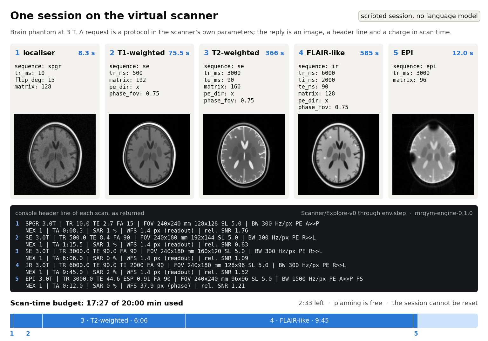
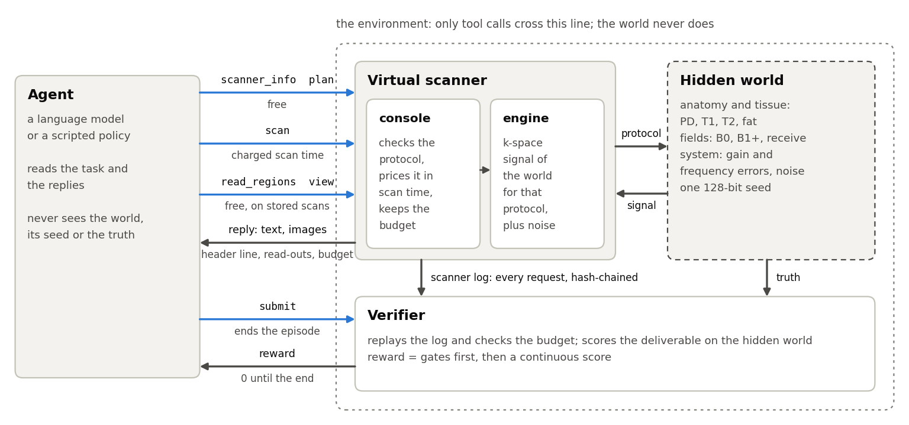
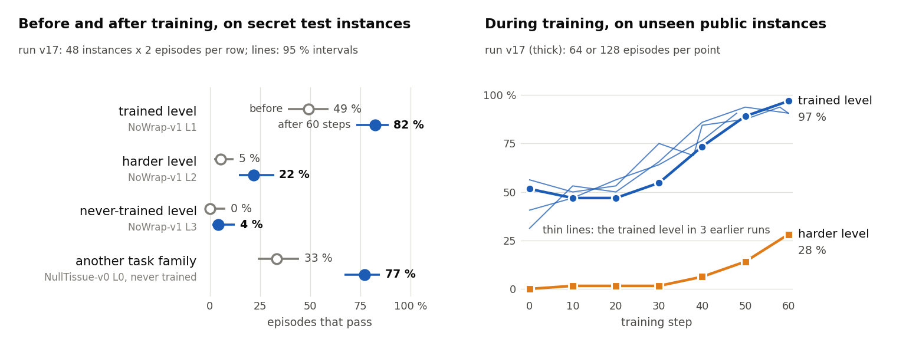
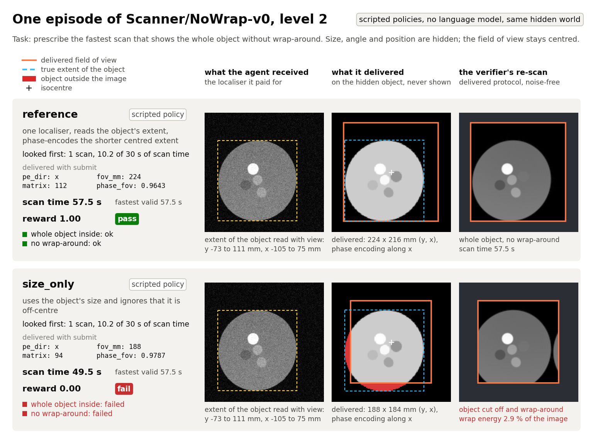

<h1 align="center">MR Gym</h1>

<p align="center">
  <b>A virtual MRI scanner for AI agents.</b><br>
  An open reinforcement-learning environment: the agent scans an object it cannot see, the scanner scores what it delivers.<br>
  <a href="LICENSE"></a>
</p>

<p align="center">
  
</p>

## What it is

- **A simulated MRI scanner.** It takes a protocol (sequence, timing, geometry) and returns the image a scanner would: formed in
  k-space, with noise, wrap-around, fat shift, banding and the other artefacts of the chosen protocol.
- **A task for an agent.** The agent gets a task text, the scanner's tools (`plan`, `scan`, `view`, `profile`, `read_regions`,
  `calc`, `submit`) and a scan-time budget. The object, the fields and the noise level are hidden.
- **A verifier.** The agent delivers a protocol or a measurement; the scanner checks it on the hidden object: reward 1 or 0.
- **A new object for every seed**, so one environment serves training and testing.

<!-- COUNTS:START -->
| 6 sequences | 5 phantoms | 2 field strengths | 25 tissue rows, each with a source tag | 63 physics checks | 10 environments (admitted, practice, sandbox) |
|---|---|---|---|---|---|
<!-- COUNTS:END -->

<p align="center">
  
</p>

## Try it

```bash
git clone https://github.com/KeWang0622/MRGym.git
cd MRGym
pip install -e .
mrgym demo
```

No GPU, no network. `mrgym demo` plays one episode with a scripted solution, then shows shortcuts that are built to fail.
The same loop from Python:

```python
import mrgym

env = mrgym.make("Scanner/NoWrap-v1", level=2, seed=0)
obs, info = env.reset()                                    # the task statement; a new hidden object
tools = env.tools("openai")                                # or "anthropic", "mcp"
obs, reward, terminated, truncated, info = env.step({"name": "scan", "arguments": {
    "sequence": "spgr", "tr_ms": 10, "flip_deg": 10, "fov_mm": 288, "matrix": 160, "averages": 2}})
```

The agent sees tools only; no tool resets the world or reads it. [examples/first_episode.py](examples/first_episode.py)

<details>
<summary><b>What <code>mrgym demo</code> prints</b>: a scripted solution, then shortcuts that must fail</summary>

<!-- DEMO:START -->
```text
$ mrgym demo
Scanner/NoWrap-v1 · level 2 · seed 0
scripted solution (no language model): shows the task can be solved through the tools
  agent -> scanner_info {}
      (instrument card, 1367 characters)
  agent -> scan {"sequence":"spgr","tr_ms":11.0,"flip_deg":10.0,"fov_mm":288.0,"matrix":160,"averages":2,"circles":[]}
      scan_index 0 · 1 image 160x160 (y, x) stored · cost 10.52 s · te_ms 3.33
      no regions requested
  agent -> view {"scan_index":0,"image_index":0,"kind":"magnitude"}
      scan_index 0 (spgr), image_index 0, magnitude, 160x160 (y, x), FOV 288 x 288 mm, pixel 1.8 x 1.8 mm
      16x16 block means, one digit per 18.0 x 18.0 mm block (y, x), 0-9 spans 0..0.4401; row = y (top = -144 mm), column = x (left = -144 mm); block centres: y_mm after each...
      0000000000000000 -136
  agent -> submit {"pe_dir":"y","fov_mm":168.0,"phase_fov":0.595238,"matrix":84,"centre_y_mm":-1.0,"centre_x_mm":16.3,"rotation_deg":90.0}
      deliverable received; the episode is over
      reward 1 · every check passed
  reward 1 · 1 scan(s), 10.5 of 30 s of scan time · scanner log replays: True
shortcuts that ignore the object: built to fail (this is what makes the reward mean something)
  prior            reward 0   no scan; the geometry that is safe for any object
  console_default  reward 0   one token scan, then the console's default field of view, centred, phase along y
  fixed_recipe     reward 0   one token scan, then one constant geometry (axis, rotation, lines; centred) tuned on other worlds
  brute_force      reward 0   shrinks a centred square field of view scan by scan until the object touches its border
  wrong_units      reward 0   the reference's geometry with every length in centimetres
other scripted controls: may pass
  size_only        reward 0   the right size and direction, with the field of view left on the isocentre
  centred_only     reward 0   the field of view left on the isocentre and enlarged until it holds the object (the v0 answer)
  no_swap          reward 0   moves the field of view but always phase-encodes along y and never turns it
  no_turn          reward 1   moves the field of view but never turns it
  open_loop        reward 1   a fixed scan list and a fixed estimator: the reference itself (no scan depends on a measurement)
  safe_max         reward 0   one scan, then the safe geometry
a language model lands between; `mrgym run-agent` plays one
```
<!-- DEMO:END -->

A level is admitted only when the shortcuts fail on fresh instances: `mrgym gate <id>`.

</details>

## The tasks

Nine scored task families and a sandbox. Each has levels; a level sets how much the task text gives away and how tight the budget is.

- `NoWrap`: prescribe the smallest, fastest field of view that holds an object of unknown size, position and orientation.
- `NullTissue`: find, for each vial, the inversion time that nulls it.
- `FatSuppress`: choose and tune the fat suppression of each region in an inhomogeneous field.
- `BandFree`: set bandwidth and phase cycling so that a balanced SSFP image has no band on the object.
- `SNRSpec`: meet a signal-to-noise requirement on two images in the least scan time.
- `PhantomQA`: run the quality tests on an ACR-style phantom and name the faults of the system, if it has any.
- `ArtefactClinic`: say what causes each artefact in an image and deliver a protocol that removes them.
- `ProtocolToSpec` and `T1Transmit` (practice): turn requirements into a protocol; measure T1 under a transmit-field error.

<details>
<summary><b>The environments</b>: given, delivered, scored by, gate result</summary>

<!-- ENVS:START -->
| Environment | Given | Deliver | Scored by | Kind | Levels of the claim | Stored gate |
|---|---|---|---|---|---|---|
| [`Scanner/ArtefactClinic-v0`](envs/scanner-artefactclinic-v0/) | A test object with hidden materials, the protocol of an examination, findings a reader marked on its image, the requirements of the examination; scan time for experiments | For each finding its causes (or none: it is the object), and one protocol that images every finding cleanly inside the requirements | Noise-free re-scan of the delivered protocol on the hidden object against its counterfactual twins (the same protocol with the artefact mechanisms switched off, and the object averaged over each pixel); the diagnosis against the mechanisms that corrupt each finding in the complaint protocol | admitted | 1, 2, 3 | on 300 fresh instances per level the reference passes >= 99 %, no policy that ignores the object passes more than 7 % (95 % bounds) |
| [`Scanner/BandFree-v0`](envs/scanner-bandfree-v0/) | A test object with vials of hidden materials in a hidden, inhomogeneous field; the scanner; a scan-time budget for probing | For each of two balanced SSFP images: the receiver bandwidth (the repetition time is the console minimum for that bandwidth) and the phase cycle; two phase cycles when one acquisition cannot be band-free | Noise-free scans of the delivered protocols on the hidden object and the echo amplitudes on the marked regions over a drift of the centre frequency either way: every marked region of an image must keep its signal; the number of acquisitions and the bandwidth are compared with the best band-free protocol of the hidden object | admitted | 1, 2, 3 | on 300 fresh instances per level the reference passes >= 94 %, no policy that ignores the object passes more than 3 % (95 % bounds) |
| [`Scanner/Explore-v0`](envs/scanner-explore-v0/) | A head, an abdomen or a QA phantom at 1.5 or 3 T; one hour of scan time | Nothing | No reward | sandbox | - | no reward |
| [`Scanner/FatSuppress-v0`](envs/scanner-fatsuppress-v0/) | A test object with several fat-containing vials (a different fat in each) in a strongly inhomogeneous field; the scanner; a scan-time budget for probing | For each marked region the method of its fat-suppressed spin-echo image: spectral fat saturation, or inversion recovery with the inversion time | Noise-free scans of the target image on the hidden object: every region must be suppressed by its method, and inversion recovery passes only where fat saturation is not enough | admitted | 1, 2, 3 | on 300 fresh instances per level the reference passes >= 98 %, no policy that ignores the object passes more than 6 % (95 % bounds) |
| [`Scanner/NoWrap-v1`](envs/scanner-nowrap-v1/) | An object of hidden size, position and orientation; the scanner; 30 s of scan time for localisers | Geometry of a spin-echo scan: phase-encode axis, field of view, phase field of view, matrix, centre, rotation | Re-scan on the hidden object: whole object inside, no wrap-around, pixel as required, scan time within 10 % of the fastest such geometry | admitted | 2, 3 (practice: 0, 1) | on 300 fresh instances per level the reference passes >= 99 %, no policy that ignores the object passes more than 6 % (95 % bounds) |
| [`Scanner/NullTissue-v0`](envs/scanner-nulltissue-v0/) | A test object with vials of hidden materials; the scanner; a scan-time budget for probing | For each marked region, the inversion time that nulls it in an inversion-recovery scan with a given repetition time | Noise-free scans of the target protocol on the hidden object: every marked region must be nulled by its inversion time | admitted | 1, 2, 3 (practice: 0) | on 300 fresh instances per level the reference passes >= 92 %, no policy that ignores the object passes more than 3 % (95 % bounds) |
| [`Scanner/PhantomQA-v0`](envs/scanner-phantomqa-v0/) | The uniform section of the ACR large phantom in a scanner with zero, one or two hidden faults; the site's ACR T1 protocol; the limits of the ACR guidance; a closed list of seven faults; a scan-time budget | The four test quantities measured on the ACR T1 scan, the tests that fail, and the faults of the system | A noise-free scan of the same protocol on the hidden system: the values must agree with the verifier's measurement, the verdicts with the guidance's limits, the faults with the hidden state | admitted | 1, 2, 3 | on 300 fresh instances per level the reference passes >= 99 %, no policy that ignores the object passes more than 3 % (95 % bounds) |
| [`Scanner/ProtocolToSpec-v0`](envs/scanner-protocoltospec-v0/) | A test object with vials of hidden materials; the scanner; the standard protocol of a two-image inversion-recovery examination; a scan-time budget for the standard protocol at low resolution and one repeat of it | For each of the two images: inversion time, echo time and number of averages (the averages share one scan-time limit) | Noise-free scans of the delivered protocols on the hidden object with the analytic noise of the hidden receiver: a T1 contrast ratio, a T2 contrast ratio and an SNR must hold for each image, and the scan times of the two images together must stay within a limit | practice | 1, 2, 3 | level(s) 1, 3 admitted; fixed_recipe#2 passes 25 of 300 (upper bound 11.4 % > 10 %) |
| [`Scanner/SNRSpec-v0`](envs/scanner-snrspec-v0/) | A test object with vials of hidden materials; the scanner; a scan-time budget for probing | For each of two spin-echo images of prescribed geometry: repetition time, number of averages and receiver bandwidth | Noise-free scans of the delivered protocols on the hidden object with the analytic noise of the hidden receiver: every marked region must reach its required SNR, in a scan time within a stated factor of the shortest that does (exhaustive search on the hidden world) | admitted | 1, 2, 3 | on 300 fresh instances per level the reference passes >= 97 %, no policy that ignores the object passes more than 3 % (95 % bounds) |
| [`Scanner/T1Transmit-v1`](envs/scanner-t1transmit-v1/) | A QA phantom with 4 to 7 vials, the scanner, a scan-time budget | T1 of every marked vial, in ms | The hidden T1 of every vial: each delivered value within a factor 1.1 of it | practice | 1, 2, 3 | level(s) 1 admitted; ignores_profile loses only 9.0 points against the reference (lower bound 6.3 < 25) |
<!-- ENVS:END -->

- **Environment**: one job with its own scoring rule. **Level**: the hidden-world prior and the budget.
  **Episode**: one seeded attempt.
- `Scanner/NoWrap-v0` and `Scanner/T1Transmit-v0` are retired: `mrgym==0.1.0` is the last package that serves them.

```bash
mrgym list
mrgym check Scanner/NoWrap-v1
```

</details>

## Does training on it work?

<!-- TRAINING:START -->
**Qwen3.8-27B, reinforcement learning only, 60 steps, the recipe below on the published code: tested on instances it never saw.**

<p align="center">
  
</p>

| On secret test instances | Before training | After 60 steps | Gain in points [95 % interval] |
|---|---|---|---|
| Trained level · `NoWrap-v1 L1` | 49 % (47 / 96) | 82 % (79 / 96) | +33.3 [+22.0, +44.7] |
| Harder level (trained; reward only late) · `NoWrap-v1 L2` | 5 % (5 / 96) | 22 % (21 / 96) | +16.7 [+7.0, +26.3] |
| Never-trained level · `NoWrap-v1 L3` | 0 % (0 / 96) | 4 % (4 / 96) | +4.2 [-0.9, +9.2] |
| Another task family (never trained) · `NullTissue-v0 L0` | 33 % (32 / 96) | 77 % (74 / 96) | +43.8 [+31.5, +56.0] |

Evidence: run `v17` at commit `18089f2`, 48 secret instances x 2 episodes per row, base and trained on the same instances. The trained level's gain was measured in 4 independent training runs: +33.3 [+22.0, +44.7] (`v17`), +57.3 [+46.9, +67.7] (`v07`), +53.1 [+38.0, +68.3] (`v09`), +44.8 [+33.5, +56.1] (`v11`). Exploratory: the pre-registered rule needs 2 trained environments, each run trained 1 that meets it. The other family's row is a practice level whose text states the method. [Full report](docs/experiments/RESULTS-27b.md).
<!-- TRAINING:END -->

## The recipe

1. **Calibrate.** Start on a level the untrained model should pass in 20-60 % of episodes: `mrgym calibrate Scanner/NoWrap-v1 --model MODEL --base-url URL --out runs/cal`
2. **Settings.** Fill the four `FILL_IN` lines of a copy: `cp recipes/qwen3.8-27b-nowrap.env my.env`
3. **Train** on one node with 8 accelerators: `bash integrations/verl/node/make_main.sh train my.env job.sh`
4. **Read out.** The job ends with trained against base on the same held-out instances: `readout.txt`
5. **Extend.** When a level saturates, add the next one to `TRAIN_ARMS`; one or two cells per run.

<!-- RECIPE_SETTINGS:START -->
```text
model      Qwen/Qwen3.8-27B · thinking off · replies up to 2,048 tokens · episode up to 8,192 prompt + 49,152 response tokens
adapter    LoRA rank 32, alpha 64 · learning rate 1e-5, 5 warm-up steps · no KL term
algorithm  GRPO in verl · 60 steps x 8 groups x 8 rollouts · bandit curriculum over the training cells
reward     1 when the delivered result passes the verifier, else 0 · no demonstrations, no supervised step
cells      train Scanner/NoWrap-v1:1,2 · read out Scanner/NoWrap-v1:1,2,3 Scanner/NullTissue-v0:0 (secret split, seeds 0-47 x 2 episodes)
```

Every line as the node scripts read it: [`recipes/qwen3.8-27b-nowrap.env`](recipes/qwen3.8-27b-nowrap.env).
<!-- RECIPE_SETTINGS:END -->

<!-- RECIPE_STATUS:START -->
Verified on the published code: run `v17` at commit `18089f2` (8 x H200, 60 steps, then its own readout). The recipe first ran on an earlier commit (`ef6d766`, run `v07`).
<!-- RECIPE_STATUS:END -->
Cost, pitfalls, other task families: **[docs/RECIPE.md](docs/RECIPE.md)**.

[Environments](envs/) · [Scanner manual](docs/scanner.md) · [Physics validation](docs/physics/validation.md) ·
[Limits](docs/physics/limits.md) · [Design](docs/DESIGN.md) · [All documentation](docs/README.md)

<details>
<summary><b>What is on the scanner</b>: tools, sequences, phantoms; images formed in k-space</summary>

- Tools: `scanner_info`, `plan`, `scan`, `read_regions`, `view`, `profile`, `status`, `calc`, one terminal tool.
  Only `scan` costs scan time.
- Sequences: spoiled gradient echo, actual flip-angle imaging, spin echo, inversion recovery, balanced SSFP, EPI.
- Hidden: the object, the transmit and receive fields, the off-resonance, the noise level.
- Everything the agent is told: [scanner manual](docs/scanner.md).

<p align="center">
  
</p>

<p align="center">
  
</p>

<p align="center">
  
</p>

```bash
mrgym scan sequence=se tr_ms=500 te_ms=15 matrix=256 --out mrgym_out/brain_t1w.png
mrgym scan --phantom abdomen sequence=spgr tr_ms=120 flip_deg=70 te_ms=3.45 matrix=192 --out mrgym_out/abdomen_opposed_phase.png
mrgym play --phantom brain --lesion ms
```

</details>

<details>
<summary><b>Watch an episode</b>: record it, step through it</summary>

<p align="center">
  
</p>

A recorded example: [examples/episode/](examples/episode/).

```bash
mrgym record Scanner/NoWrap-v1 --level 2 --seed 0 --policy reference --out runs/demo
mrgym view runs/demo/episode_bundle.json --out runs/demo/viewer.html
```

</details>

<details>
<summary><b>Results table of API models</b>: no published row; pilot records kept</summary>

<!-- RESULTS:START -->
No row is published yet. A published row needs at least 300 instances per environment, 2 episodes per instance for a model, and records that store the whole conversation. 1400 pilot episode records (played 2026-11-24, UTC) are listed with their intervals in [results/README.md](results/README.md); no comparison is computed from them.
<!-- RESULTS:END -->

- The pilot records are history of package 0.1.0: they were played on the retired `-v0` ids.
- `mrgym run-agent` adds model rows: [results/](results/), [docs/ANALYSIS_PLAN.md](docs/ANALYSIS_PLAN.md).

```bash
mrgym results --check
```

</details>

<details>
<summary><b>Physics checks and timing</b></summary>

[Validation table](docs/physics/validation.md) · [conventions](docs/physics/conventions.md) ·
[textbook experiments](examples/textbook/)

```bash
mrgym validate
mrgym timing
```

Seconds of computation per scan:

<!-- TIMING:START -->
| Sequence | matrix 64 | matrix 128 | matrix 256 |
|---|---:|---:|---:|
| spgr | 0.21 | 0.22 | 0.26 |
| spgr, 4 echoes | 0.54 | 0.60 | 0.74 |
| afi | 0.37 | 0.40 | 0.48 |
| se | 0.19 | 0.21 | 0.26 |
| ir | 0.19 | 0.21 | 0.26 |
| bssfp | 0.21 | 0.23 | 0.28 |
| epi | 0.23 | 0.26 | refused |

world generation, once per episode: brain 0.66 s, abdomen 0.66 s, qa 0.07 s
brain phantom at 3 T, one thread, median of 3, noise-free data not cached; a repeated protocol reuses it
<!-- TIMING:END -->

</details>

<details>
<summary><b>Limits</b>: what this does not show</summary>

- Simulated objects only: a pass does not establish that an agent can operate a real scanner.
- No independent expert review of any environment.
- The generator is public: the secret split hides instances behind a key, not the task.
- One slice, one receive channel, no fast spin echo, no motion: [limits.md](docs/physics/limits.md).
- The gate shows that the listed shortcuts fail, not that no shortcut exists.
- Training: exploratory first runs, one sampler seed each: [their limits](docs/experiments/RESULTS-27b.md).

</details>

<details>
<summary><b>Repository map</b></summary>

| Path | Contents |
|---|---|
| [`src/mrgym/scanner/`](src/mrgym/scanner/) | World, console, signal models, k-space engine, log and replay |
| [`src/mrgym/envs/`](src/mrgym/envs/) | Task, control policies and stored gate result of each family |
| [`integrations/verl/`](integrations/verl/), [`recipes/`](recipes/) | Trainer integration, node scripts, settings |
| [`envs/`](envs/), [`results/`](results/) | Environment cards; episode records |
| [`docs/`](docs/), [`examples/`](examples/), [`tools/`](tools/) | Documentation; examples; generators |
| [`extras/recon_repair/`](extras/recon_repair/) | A code-repair task set, not part of `mrgym`; read its warning first |

</details>

<details>
<summary><b>Skills, evaluation, contribute, cite</b></summary>

- [MRFoundry](https://github.com/KeWang0622/MRFoundry): skills and tools for MRI research agents.
- [MRI Agent Bench](https://github.com/KeWang0622/MRIAgentBench): the held-out evaluation. Nothing of it is used
  here; [a test](tests/test_no_benchmark_content.py) keeps it that way.
- [CONTRIBUTING.md](CONTRIBUTING.md) · [CITATION.cff](CITATION.cff) · Apache-2.0 · research preview

```bash
pip install pytest
pytest -q
python tools/generate.py --check
```

</details>
