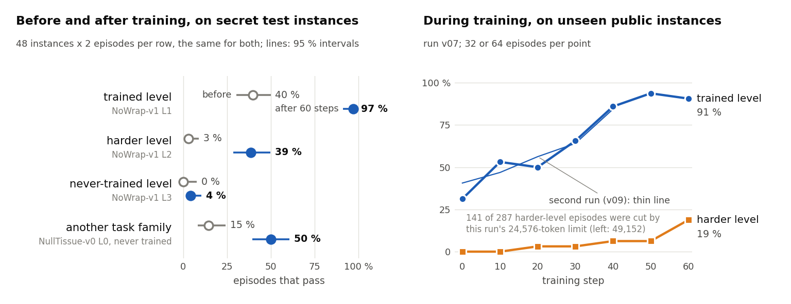

# Recipe: train an open-weight model on MR Gym

The model plays episodes through the scanner's tools and is trained on the reward alone.

<!-- RECIPE_STATUS:START -->
Verified on commit `ef6d766` (run `v07`, 8 x H100 with 24,576-token responses; readout on 8 x H200 at 49,152). Check on the current code (commit `18089f2`, run `v17`, 8 x H200): started; no data yet.
<!-- RECIPE_STATUS:END -->

## What to expect

<!-- TRAINING:START -->
**Qwen3.8-27B, reinforcement learning only, 60 steps: tested on instances it never saw.**

<p align="center">
  
</p>

| On secret test instances | Before training | After 60 steps | Gain in points [95 % interval] |
|---|---|---|---|
| Trained level · `NoWrap-v1 L1` | 40 % (38 / 96) | 97 % (93 / 96) | +57.3 [+46.9, +67.7] |
| Harder level (trained; reward only late) · `NoWrap-v1 L2` | 3 % (3 / 96) | 39 % (37 / 96) | +35.4 [+23.8, +47.0] |
| Never-trained level · `NoWrap-v1 L3` | 0 % (0 / 96) | 4 % (4 / 96) | +4.2 [+0.1, +8.2] |
| Another task family (never trained) · `NullTissue-v0 L0` | 15 % (14 / 96) | 50 % (48 / 96) | +35.4 [+21.1, +49.8] |

Evidence: one run, one seed, 48 secret instances x 2 episodes per row, base and trained on the same instances; exploratory (the pre-registered rule needs 2 trained environments, 1 was trained). The other family's row is a practice level whose text states the method. [Full report](../docs/experiments/RESULTS-27b.md).
<!-- TRAINING:END -->

## What you need

<!-- RECIPE_NEEDS:START -->
- **Model:** `Qwen/Qwen3.8-27B`, open weights. The trainer is [verl](../integrations/verl/README.md) at its pinned commit.
- **One node with 8 accelerators.** Run `v07` trained on 8 x H100 (80 GB each) with 24,576-token responses; the settings of this page (49,152-token responses) run on 8 x H200 (141 GB each).
- **Training:** 7.3 node hours for 60 steps (`v07`, 3 attempts after 2 preemptions).
- **Readout:** 0.8 node hours for the base model and the final weights, 384 episodes each, on 8 x H200.
- Hours run from the start of each attempt to its last logged episode (the `utc` stamps of the stored logs); the first set-up of a node (environments, weights) is not in them.
<!-- RECIPE_NEEDS:END -->

## Settings

<!-- RECIPE_SETTINGS:START -->
```text
model      Qwen/Qwen3.8-27B · thinking off · replies up to 2,048 tokens · episode up to 8,192 prompt + 49,152 response tokens
adapter    LoRA rank 32, alpha 64 · learning rate 1e-5, 5 warm-up steps · no KL term
algorithm  GRPO in verl · 60 steps x 8 groups x 8 rollouts · bandit curriculum over the training cells
reward     1 when the delivered result passes the verifier, else 0 · no demonstrations, no supervised step
cells      train Scanner/NoWrap-v1:1,2 · read out Scanner/NoWrap-v1:1,2,3 Scanner/NullTissue-v0:0 (secret split, seeds 0-47 x 2 episodes)
```

Every line as the node scripts read it: [`recipes/qwen3.8-27b-nowrap.env`](../recipes/qwen3.8-27b-nowrap.env).
<!-- RECIPE_SETTINGS:END -->

## Steps

```
# 0  once: the package, and a key for held-out instances of your own
pip install -e .
mrgym epoch keygen --out secret.key

# 1  settings: fill RUN_ID, OUT_URI, REPO_SRC and SECRET_URI
cp recipes/qwen3.8-27b-nowrap.env my.env

# 2  calibrate: where does the untrained model stand, and how long are its episodes?
sed 's/^RUN_ID=.*/RUN_ID=nowrap-cal/' my.env > cal.env
bash integrations/verl/node/make_main.sh calibrate cal.env cal_job.sh      # run cal_job.sh on the node
#    -> <OUT_URI>/runs/nowrap-cal/calibration_summary.md: pass rate, mixed groups and stream tokens per cell
#    or, against an endpoint that already serves the model with thinking off:
mrgym calibrate Scanner/NoWrap-v1 --levels 1,2,3 --model MODEL --base-url http://HOST:8000/v1 \
    --n 8 --episodes 8 --max-tokens 2048 --max-turns 0 --out runs/cal

# 3  train: evaluates on public dev instances every TEST_FREQ steps, ends with the readout
bash integrations/verl/node/make_main.sh train my.env job.sh               # run job.sh on the node
#    -> <OUT_URI>/runs/<RUN_ID>/remote/metrics.json during the run; readout.txt and readout.json at the end

# 4  the readout again, from the two evaluation logs of the run
PYTHONPATH=integrations/verl python -m mrgym_verl.readout --untrained Scanner/NullTissue-v0 --min-envs 1 \
    --base remote/test_base/episodes.jsonl --trained remote/test_trained/episodes.jsonl --out readout.json
```

- **One job, one script.** `make_main.sh` writes the settings into a copy of the entry script. The job resumes under
  the same `RUN_ID` after a preemption, until it has finished, failed or been stopped by a rule.
- **A stop by a rule is a result.** The job writes `STOP.json` with the rule and its numbers and keeps the checkpoint.
- **Your key, your instances.** The secret split is drawn from your key: the same distribution as in the table above,
  other instances.
- **Without a node first.** `bash integrations/verl/simulate.sh <empty folder> <python>` runs the three entry scripts
  with stand-ins for the model and the trainer.

## Pitfalls

<!-- RECIPE_PITFALLS:START -->
1. **The episode token limit.** A limit that is too small hides learning. The step-50 weights pass the harder level in 2 / 32 dev episodes on the 24,576-token response limit (22 cut by length, run `v07`) and in 15 / 64 on the 49,152-token limit (run `v13`).
2. **Start where there is signal.** The reward is pass or nothing, so a cell near zero gives no gradient: start where the untrained model passes 20-60 % of the episodes with a pass and a failure in the same group, and keep the next level beside it. In `v07` the harder level gave 2 / 176 passing rollouts in steps 1-10 and 74 / 432 in steps 51-60, after the first level had gone from 171 / 464 to 197 / 208.
3. **Few cells per run.** `v09` trained 4 cells at 8 groups per step: on dev the first level went from 13 / 32 to 27 / 32 by step 40, the others stayed near their start (NoWrap-v1 L2 0 / 32 then 1 / 31, NullTissue-v0 L0 5 / 32 then 2 / 32, PhantomQA-v0 L1 3 / 32 then 5 / 30).
4. **One look is noise.** In run `v07` the weights of step 40 were evaluated 2 times on the same instances: 30 / 32 and 25 / 32 on NoWrap-v1 level 1. Judge by the paired readout on held-out instances, trained against base on the same instances, not by one evaluation.
<!-- RECIPE_PITFALLS:END -->

## Another task family

Where the untrained model stands on every cell of the suite, with thinking off:

<!-- RECIPE_REACH:START -->
| Band | Pass rate of the untrained model | Cells (calibration `c05`: thinking off, chat harness, 8 instances x 8 episodes) | Use |
|---|---|---|---|
| comfortable | 60 - 80 % | NoWrap-v1 L0 (50 / 64), NoWrap-v1 L1 (43 / 64) | keep in the mix |
| entry | 20 - 60 % | NullTissue-v0 L0 (36 / 64) | where a run starts |
| frontier | 2 - 20 % | NullTissue-v0 L3 (3 / 64), PhantomQA-v0 L1 (9 / 64), PhantomQA-v0 L2 (7 / 64), PhantomQA-v0 L3 (6 / 64), T1Transmit-v1 L1 (6 / 64) | only inside a curriculum next to an easier level |
| dead | 0 - 2 % | 21 cells of 8 families | never train on it: add an easier level or warm-start the model |

The trainer's token stream is stricter than the chat harness (a reply cut by the token limit ends the episode), and `v07` ran on an earlier interface: NoWrap-v1 L1 is 43 / 64 in this calibration and was 20 / 64 at step 0 of `v07`. The step-0 evaluation of a run is the number that decides.
<!-- RECIPE_REACH:END -->

- **Entry:** start there. Set `TRAIN_ARMS`, `CAL_PLAN` and `BASE_RATE`, and `MAX_RESPONSE_LEN` above the 99th
  percentile of the calibration's stream tokens.
- **Frontier:** only beside a level of the same family that already gives reward, as in this recipe.
- **Dead:** not from this reward at this model setting. With reasoning on the model reaches several of these cells,
  but such an episode does not fit one accelerator; the per-cell table is section 5 of the
  [report](experiments/RESULTS-27b.md).

More: [the full report](experiments/RESULTS-27b.md) · [what a trainer gets from an environment](TRAINING.md) ·
[the verl integration](../integrations/verl/README.md) · [the pre-registration](experiments/PREREG-27b.md)
