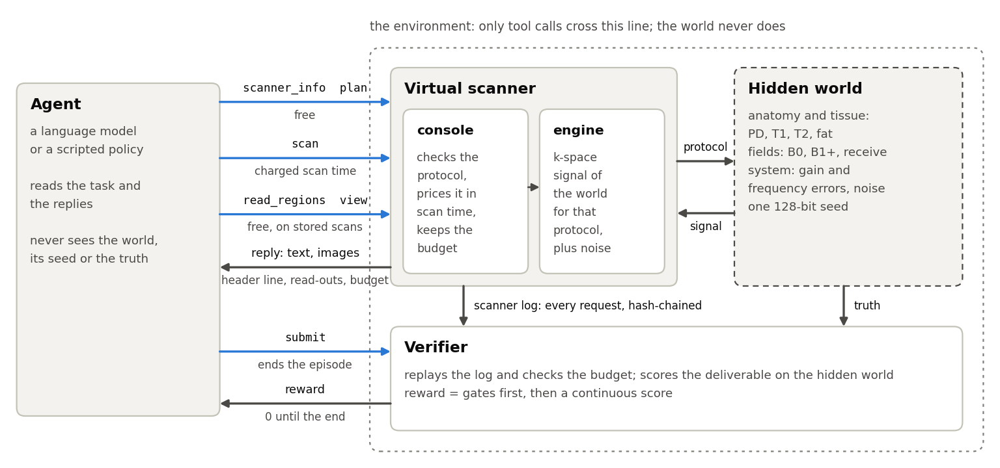
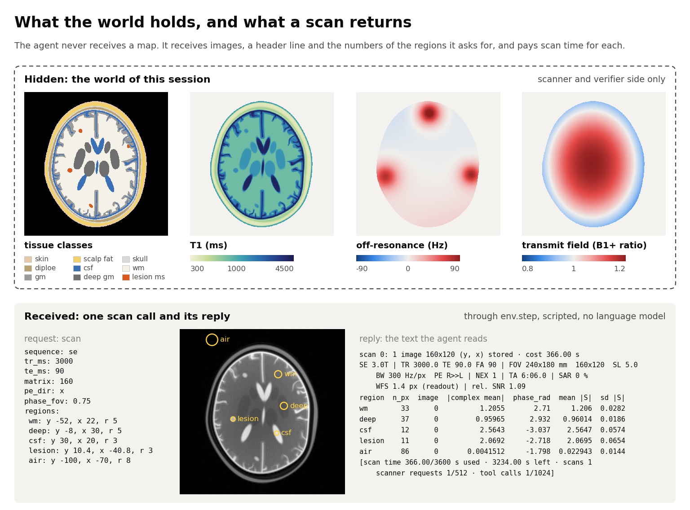
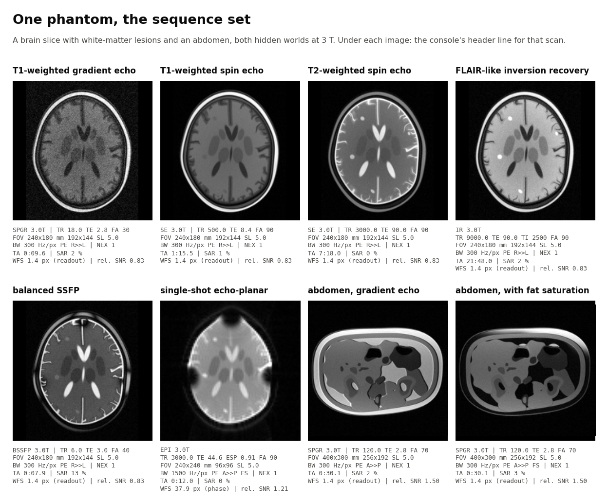
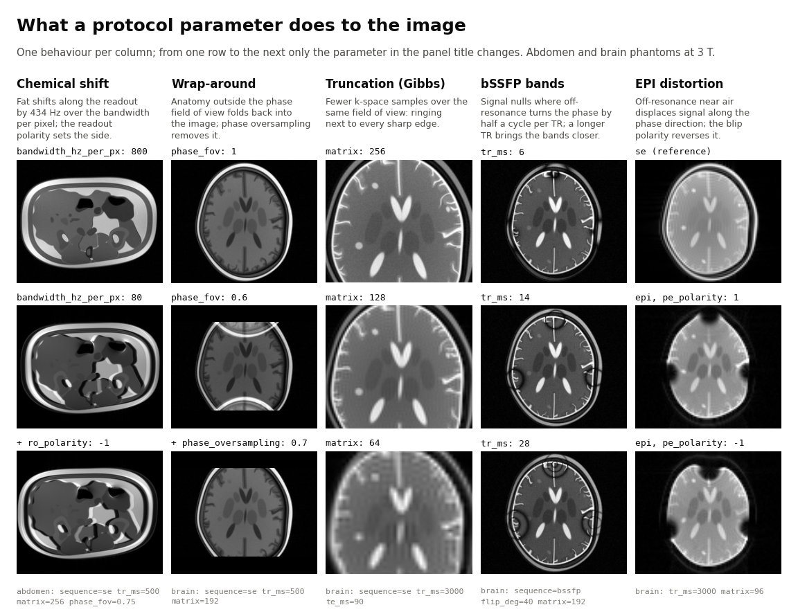
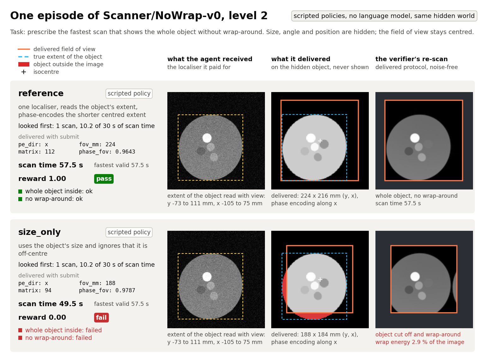

# A tour of MR Gym

What is in the box: the demo, the scanner, an episode, speed, limits and where things are in the repository. The
[README](../README.md) is the short version; the [scanner manual](scanner.md) is what the agent reads.

<!-- COUNTS:START -->
| 6 sequences | 5 phantoms | 2 field strengths | 25 tissue rows, each with a source tag | 135 physics checks | 26 environments (admitted, candidate, practice, sandbox) |
|---|---|---|---|---|---|
<!-- COUNTS:END -->

<p align="center">
  
</p>

- An environment is one job with its own scoring rule. A level sets how much is hidden and how tight the budget is.
  An episode is one seeded attempt.
- Every environment has a card with what is given, delivered and scored, and its gate result: [envs/](../envs/README.md).
- `Scanner/NoWrap-v0` and `Scanner/T1Transmit-v0` are retired: `mrgym==0.1.0` is the last package that serves them.

```bash
mrgym list
mrgym check Scanner/NoWrap-v1
```

## What `mrgym demo` prints

A scripted solution, then shortcuts that must fail.

<!-- DEMO:START -->
```text
$ mrgym demo
Scanner/NoWrap-v1 · level 2 · seed 0
scripted solution (no language model): shows the task can be solved through the tools
  agent -> scanner_info {}
      (instrument card, 1380 characters)
  agent -> scan {"sequence":"spgr","tr_ms":11.0,"flip_deg":10.0,"fov_mm":288.0,"matrix":160,"averages":2,"circles":[]}
      scan_index 0 · 1 image 160x160 (y, x) stored · cost 10.52 s · te_ms 3.32
      no regions requested
  agent -> view {"scan_index":0,"image_index":0,"kind":"magnitude"}
      scan_index 0 (spgr), image_index 0, magnitude, 160x160 (y, x), FOV 288 x 288 mm, pixel 1.8 x 1.8 mm
      16x16 block means, one digit per 18.0 x 18.0 mm block (y, x), 0-9 spans 0..0.4376; row = y (top = -144 mm), column = x (left = -144 mm); block centres: y_mm after each...
      0000000000000000 -136
  agent -> submit {"pe_dir":"y","fov_mm":168.0,"phase_fov":0.595238,"matrix":84,"centre_y_mm":-1.0,"centre_x_mm":16.3,"rotation_deg":90.0}
      deliverable received; the episode is over
      reward 1 · every check passed
  reward 1 · 1 scan(s), 10.5 of 30 s of scan time · scanner log replays: True
shortcuts that ignore the object: built to fail (this is what makes the reward mean something)
  prior            reward 0   no scan; the geometry that is safe for any object
  console_default  reward 0   one token scan, then the console's default field of view, centred, phase along y
  fixed_recipe     reward 0   one token scan, then one constant geometry (axis, rotation, lines; centred) tuned on other worlds
  brute_force      reward 0   shrinks a centred square field of view scan by scan until the object touches its border
  wrong_units      reward 0   the reference's geometry with every length in centimetres
other scripted controls: may pass
  size_only        reward 0   the right size and direction, with the field of view left on the isocentre
  centred_only     reward 0   the field of view left on the isocentre and enlarged until it holds the object (the v0 answer)
  no_swap          reward 0   moves the field of view but always phase-encodes along y and never turns it
  no_turn          reward 1   moves the field of view but never turns it
  open_loop        reward 1   a fixed scan list and a fixed estimator: the reference itself (no scan depends on a measurement)
  safe_max         reward 0   one scan, then the safe geometry
a language model lands between; `mrgym run-agent` plays one
```
<!-- DEMO:END -->

A level is admitted only when the shortcuts fail on fresh instances: `mrgym gate <id>`.

## What is on the scanner

- Tools: `scanner_info`, `plan`, `scan`, `read_regions`, `view`, `profile`, `status`, `calc`, one terminal tool.
  Only `scan` costs scan time.
- Sequences: spoiled gradient echo, actual flip-angle imaging, spin echo, inversion recovery, balanced SSFP, EPI.
- Hidden: the object, the transmit and receive fields, the off-resonance, the noise level.
- Everything the agent is told: [scanner manual](scanner.md).

<p align="center">
  
</p>

<p align="center">
  
</p>

<p align="center">
  
</p>

```bash
mrgym scan sequence=se tr_ms=500 te_ms=15 matrix=256 --out mrgym_out/brain_t1w.png
mrgym scan --phantom abdomen sequence=spgr tr_ms=120 flip_deg=70 te_ms=3.45 matrix=192 --out mrgym_out/abdomen_opposed_phase.png
mrgym play --phantom brain --lesion ms
```

## Watch an episode

<p align="center">
  
</p>

A recorded example: [examples/episode/](../examples/episode/).

```bash
mrgym record Scanner/NoWrap-v1 --level 2 --seed 0 --policy reference --out runs/demo
mrgym view runs/demo/episode_bundle.json --out runs/demo/viewer.html
```

## Results of API models

<!-- RESULTS:START -->
No row is published yet. A published row needs at least 300 instances per environment, 2 episodes per instance for a model, and records that store the whole conversation. The rows of 1400 pilot episode records (played 2026-11-24 UTC on retired ids; the records themselves are not stored) are listed with their intervals in [results/README.md](results/README.md); no comparison is computed from them.
<!-- RESULTS:END -->

- `mrgym run-agent` plays a model and writes one record per episode. `mrgym results` builds the table of a run folder:
  [results/README.md](results/README.md), [ANALYSIS_PLAN.md](ANALYSIS_PLAN.md).
- For training an open-weight model see [RECIPE.md](RECIPE.md) and [experiments/RESULTS-27b.md](experiments/RESULTS-27b.md).

```bash
mrgym results --check --dir docs/results
```

## Physics checks and timing

[Validation table](physics/validation.md) · [conventions](physics/conventions.md) ·
[textbook experiments](../examples/textbook/)

```bash
mrgym validate
mrgym timing
```

Seconds of computation per scan:

<!-- TIMING:START -->
| Sequence | matrix 64 | matrix 128 | matrix 256 |
|---|---:|---:|---:|
| spgr | 0.21 | 0.22 | 0.26 |
| spgr, 4 echoes | 0.54 | 0.60 | 0.74 |
| afi | 0.37 | 0.40 | 0.48 |
| se | 0.19 | 0.21 | 0.26 |
| ir | 0.19 | 0.21 | 0.26 |
| bssfp | 0.21 | 0.23 | 0.28 |
| epi | 0.23 | 0.26 | refused |

world generation, once per episode: brain 0.66 s, abdomen 0.66 s, qa 0.07 s
brain phantom at 3 T, one thread, median of 3, noise-free data not cached; a repeated protocol reuses it
<!-- TIMING:END -->

## Limits

What this does not show.

- Simulated objects only: a pass does not establish that an agent can operate a real scanner.
- No independent expert review of any environment.
- The generator is public: the secret split hides instances behind a key, not the task.
- One slice, one receive channel, no echo train in any environment (a console can list one), no motion:
  [limits.md](physics/limits.md).
- The gate shows that the listed shortcuts fail, not that no shortcut exists.
- Training: exploratory first runs, one sampler seed each: [their limits](experiments/RESULTS-27b.md).

## Repository map

| Path | Contents |
|---|---|
| [`src/mrgym/scanner/`](../src/mrgym/scanner/) | World, console, signal models, k-space engine, log and replay |
| [`src/mrgym/envs/`](../src/mrgym/envs/) | Task, control policies and stored gate result of each family |
| [`envs/`](../envs/README.md) | Environment cards, generated from the registry |
| [`examples/`](../examples/) | A first episode, a language model as the agent, textbook experiments, a new task family |
| [`integrations/`](../integrations/README.md), [`recipes/`](../recipes/) | Adapters for other frameworks, the trainer integration, training settings |
| [`docs/`](README.md), [`assets/`](../assets/) | Documentation; the figures (drawn by `tools/figures/`) |
| [`tools/`](../tools/) | Generators (`generate.py`), the audit of the tests, the conformance scorecard, CI files |
| [`tests/`](../tests/) | The test suite |

## Related

- [MRFoundry](https://github.com/KeWang0622/MRFoundry): skills and tools for MRI research agents.
- [MRI Agent Bench](https://github.com/KeWang0622/MRIAgentBench): the held-out evaluation. Nothing of it is used
  here; [a test](../tests/test_no_benchmark_content.py) keeps it that way.
- Contribute: [CONTRIBUTING.md](../CONTRIBUTING.md), [ADDING_A_TASK.md](ADDING_A_TASK.md).

```bash
pip install pytest
pytest -q
python tools/generate.py --check
```
